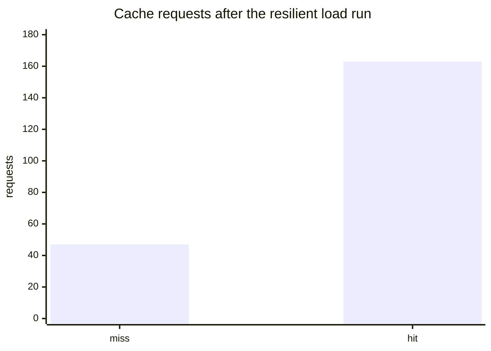
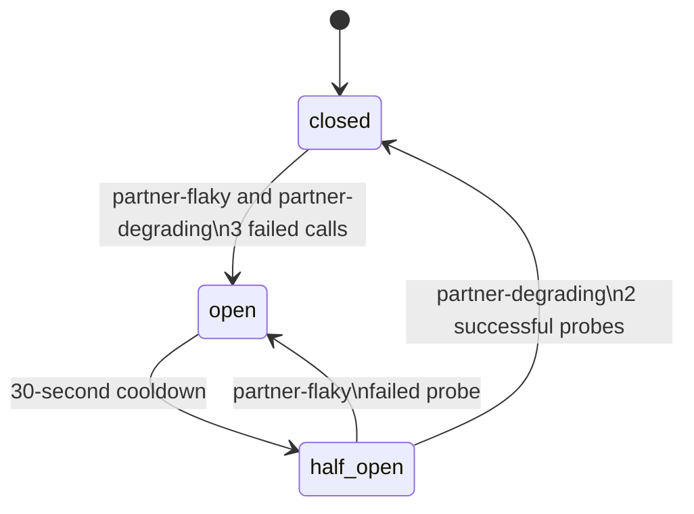
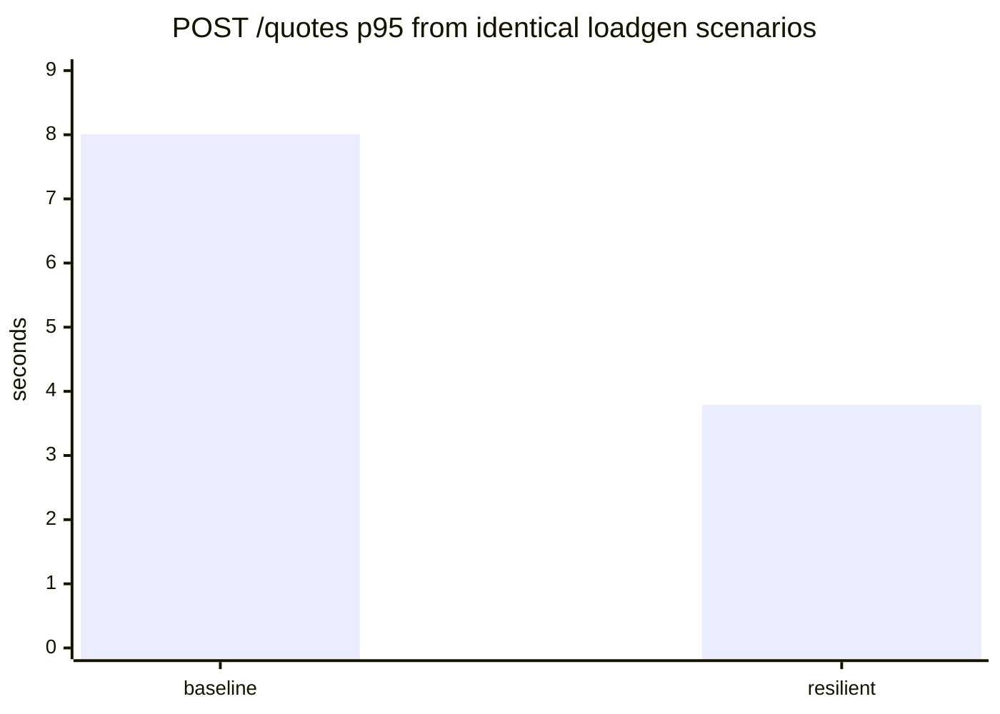

# Prometheus observations

All queries below were executed against `http://localhost:9090` during the resilient run on 24 November 2026. The PromQL range window is `[5m]` unless the query is an instant counter read.

## Cache warm-up

Command:

```bash
curl -fsSG 'http://localhost:9090/api/v1/query' \
  --data-urlencode 'query=sum by (result) (quotation_cache_requests_total)'
```

Observed result immediately after the 210-request scenario: `163` cache hits and `47` misses, a 77.6% cache-hit rate. The initial misses populate the five distinct risks while concurrent cold requests race; subsequent requests are served without partner spans.



## Circuit breaker state transitions

Command:

```bash
curl -fsSG 'http://localhost:9090/api/v1/query' \
  --data-urlencode 'query=sum by (partner, from_state, to_state) (quotation_breaker_transitions_total)'
```

The run observed `closed → open` and `open → half-open` for `partner-flaky` and `partner-degrading`. `partner-degrading` then completed `half-open → closed`; `partner-flaky` returned `half-open → open` after an unsuccessful probe. This makes all three operational states externally observable.



## API p95 latency

Command:

```bash
curl -fsSG 'http://localhost:9090/api/v1/query' \
  --data-urlencode 'query=histogram_quantile(0.95, sum by (le) (rate(http_server_request_duration_seconds_bucket{http_request_method="POST",http_route="/quotes"}[5m])))'
```

Prometheus returned `4.20 s` in the rolling five-minute window, which also included later cache and circuit verification calls. The like-for-like `loadgen` report is the comparison source: p95 improved from `8.01 s` before the change to `3.79 s` after it.



## Partner-domain latency

Command:

```bash
curl -fsSG 'http://localhost:9090/api/v1/query' \
  --data-urlencode 'query=histogram_quantile(0.95, sum by (le, partner) (rate(quotation_partner_quote_duration_seconds_bucket[5m])))'
```

The histogram is emitted only while a real partner call is attempted. A short-circuited breaker call and a cache hit do not add partner-call latency, which is the intended proof that neither sends an insurer request.
