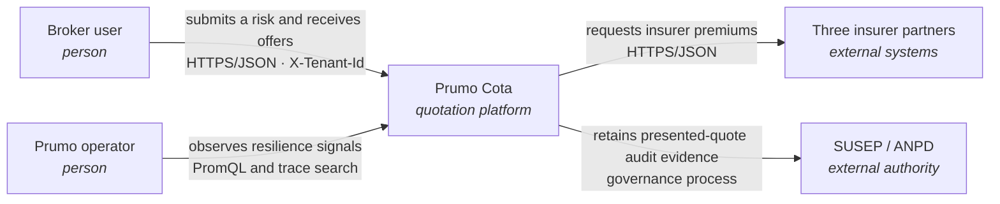
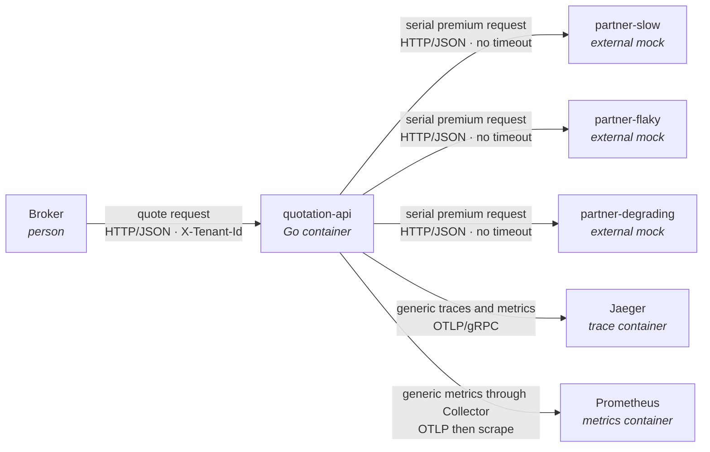
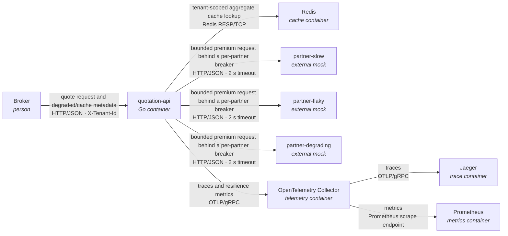
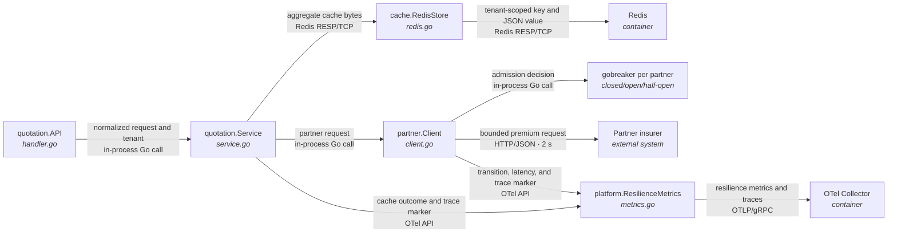

# Solution Architecture Document — Prumo Cota Resilience

**Status:** implemented proof of concept
**Audience:** Prumo Technology leadership, on-call operators, and data-protection/audit personnel
**Scope:** the quotation API and its boundary with three insurer partners

## 1. Introduction

Prumo Cota is a multi-tenant software platform used by insurance brokers. A broker sends a driver and vehicle risk to `POST /quotes`; the platform asks three independent insurers for real premiums and orders the results by price. Prumo does not calculate a premium and must not invent one when an insurer is unavailable.

This document decides the resilience slice delivered by the PoC: a tenant-isolated aggregate cache, one circuit breaker per insurer, bounded external calls, and a visible partial-response fallback. It links the requirements in [section 3](#3-functional-and-non-functional-requirements) to the mechanism in [section 4](#4-architecture-decisions), source files in [section 5](#5-implementation-and-hosting), alerts in [section 6](#6-operations-and-change-management), recovery in [section 7](#7-disaster-recovery), and costs in [section 8](#8-technology-cost-and-people).

### Scope

Included:

- `POST /quotes`, `X-Tenant-Id` validation, and the response contract;
- calls from `internal/partner/client.go` to partner insurer APIs;
- Redis caching, circuit breakers, timeout, partial fallback, and OpenTelemetry evidence;
- decisions for operational ownership, auditability, and disaster recovery.

Excluded:

- insurer price calculation, policy issuance, broker CRM, user authentication, retries, bulkheads, rate limiting, queues, Kubernetes, and a persistent audit implementation;
- changing `cmd/partner-mock/` or its Compose failure profiles;
- parallel partner aggregation. The PoC deliberately remains serial so the mandatory mechanisms remain isolated.

### Constraints

| Constraint | Source | Consequence |
| --- | --- | --- |
| Go 1.25, Docker Compose v2, Redis, OpenTelemetry, and Mermaid are mandatory. | [Challenge brief](enunciado.md) | The PoC uses Go 1.25-compatible `go-redis/v9` v9.22.0, `gobreaker/v2` v2.4.0, Compose, and Mermaid diagrams. |
| A partner query costs R$0.04; a quote queries three partners. | [Challenge brief](enunciado.md) | A circuit that is open must prevent the outbound call, and a cache hit must prevent all three. |
| Quotes are valid commercially for at most 24 hours. | [Challenge brief](enunciado.md) | Cache TTL is well below this ceiling. |
| Prumo is an LGPD operator and each broker has separate commercial terms. | [Challenge brief](enunciado.md) | `tenant_id` is part of the cache key, and no CPF, plate, or quote ID is exported as telemetry. |
| Every presented quote is audit-retained for five years under SUSEP. | [Challenge brief](enunciado.md) | Caching does not remove the future audit-record obligation. Persistent audit storage is an explicit next step, not silently claimed as delivered. |

### Assumptions

| Assumption | Value and origin | Consequence if false |
| --- | --- | --- |
| Repeated quotations within one hour are common enough to sustain a 30–45% production hit rate. | Business scenario says brokers re-quote during the same customer conversation; the 77.6% test hit rate is deliberately not reused as a production assumption. | At 5% recurrence, the cache still protects latency but its financial payback in [section 8](#8-technology-cost-and-people) must be recalculated before scale-out. |
| An insurer response slower than two seconds is worse for the broker than a partial result. | The untouched sequential baseline p95 is 2.04 s with one request in flight; the broker is waiting with a customer. | The timeout will create unnecessary partial quotes; product leadership must raise `PARTNER_TIMEOUT` and rerun the evidence. |
| A short insurer outage is independent by partner. | The scenario models three independent insurers and their own maintenance windows. | A correlated outage would yield no real quotes; the current fallback cannot turn an all-partner outage into a successful quote. |

## 2. Architecture overview

### C4 level 1 — system context

Prumo is an intermediary: it forwards a broker-specific risk to insurers and returns insurer-owned premiums. The architecture serves brokers who need an answer during a sales conversation, operations staff who need a bounded failure mode, and audit staff who must prove tenant separation and provenance.

### C4 level 2 — before the PoC

Before the intervention, an insurer failure aborted the entire request, partner calls had no timeout, and Redis was unused. The measured standard workload produced 60% success and 8.01 s p95 under load; see [baseline report](evidencias/baseline-load-report.txt).

### C4 level 2 — after the PoC

Delta from the original architecture:

1. A Redis aggregate cache is checked before any insurer call.
2. Each partner has an independent in-process breaker and a two-second HTTP client timeout.
3. Complete live results are cached for one hour; partial results are never cached.
4. A request with at least one real premium returns a visible partial result instead of a whole-request 502.
5. Breaker transitions, cache outcomes, partner latency, cache hits, and circuit rejections are observable.

## 3. Functional and non-functional requirements

### Functional requirements

| ID | Testable requirement | Traceability |
| --- | --- | --- |
| RF-01 | `POST /quotes` accepts a known `X-Tenant-Id` and returns insurer premiums in ascending `premium_cents` order. | `internal/quotation/handler.go` and `internal/quotation/service.go` |
| RF-02 | A broker receives only premiums obtained from an insurer or an identifiable cached prior response; Prumo never calculates a premium. | `internal/quotation/service.go` |
| RF-03 | A cache entry for the same normalized risk cannot be reused by another tenant. | `quotationCacheKey` and `TestQuoteCachesByTenantAndNormalizedRisk` |
| RF-04 | A complete live response is reusable for one hour and identifies `source=cache` with its age. | `internal/quotation/service.go` |
| RF-05 | If one or two partners fail, the response remains HTTP 200 with `degraded=true` and the unavailable partner names; only available real quotes are included. | `TestOnePartnerDownReturnsTheAvailableQuotesAsDegraded` |
| RF-06 | An open partner circuit does not send a new HTTP request to that partner and marks the trace. | `TestQuoteOpensTheCircuitWithoutCallingThePartnerAgain` and [circuit trace](evidencias/circuit-open-trace.json) |

### Non-functional requirements

| ID | Requirement | Metric and target | Before / measured result | Method | Origin of target |
| --- | --- | --- | --- | --- | --- |
| RNF-01 | Availability under the default workload | successful `POST /quotes` responses ≥95% | 60% before; 100% after | identical `loadgen` reports | A broker needs a result during a sales interaction. |
| RNF-02 | Load latency | p95 ≤4 s under the standard 200-request, 50-in-flight phase | 8.01 s before; 3.79 s after | `loadgen` and `http_server_request_duration_seconds` | Keeps the protected path below half the measured failure baseline. |
| RNF-03 | Partner wait time | one outbound call ≤2 s | unbounded client timeout before; bounded in code | `PARTNER_TIMEOUT=2s` and client test | The single-request baseline p95 is 2.04 s; waiting longer than this for one dependency is not useful. |
| RNF-04 | Tenant isolation | zero cross-tenant cache reuse | no cache before; two entries in deterministic cache test | `TestQuoteCachesByTenantAndNormalizedRisk` | LGPD controller/operator separation and broker-specific pricing. |
| RNF-05 | Operational visibility | breaker transitions, cache outcome, and partner duration queryable within 10 s | generic HTTP telemetry only before; all three present after | [Prometheus observations](evidencias/prometheus-observations.md) | The existing periodic metric reader is configured for 10 seconds. |
| RNF-06 | Data minimization in telemetry | zero CPF, plate, or quote ID labels or span attributes | verified by source review and trace exports | `internal/platform/metrics.go` and traces | LGPD minimization and bounded metric cardinality. |

## 4. Architecture decisions

### Decision A — circuit breaker and timeout

**Context.** `partner-flaky` returns deterministic 503s and `partner-degrading` slows down under concurrent traffic. The original unbounded client accumulated slow calls, and a global breaker would let one insurer remove unrelated offers.

**Options considered.**

1. Retry failures: rejected because it increases partner cost and pressure, and retry is out of scope.
2. One global breaker: rejected because a degrading insurer would suppress healthy insurers.
3. Per-(partner, tenant) breakers: rejected for the PoC because it allows many tenants to keep calling the same failing insurer and delays protection.
4. One breaker per partner: selected.

**Choice.** `github.com/sony/gobreaker/v2` implements an in-process breaker for each `platform.Partner.Name`. Three consecutive errors inside a 30-second closed-state interval transition `closed → open`. An HTTP timeout is an error and counts toward the same threshold. The circuit remains open for 30 seconds, permits two probes in `half-open`, closes after two successes, and reopens on a probe failure. The outbound `http.Client` has `Timeout: 2s`. An open or saturated half-open circuit returns before `http.Client.Do`, so no insurer call or cost is incurred.

**Consequences.** The selected threshold opens within the documented nine-failure burst while tolerating isolated 40% failure. It may still let three paid failures through before it protects the partner. The breaker is process-local; a restart loses learned state. It deliberately does not retry a timeout.

### Decision B — aggregate cache and tenant key

**Context.** Three insurer calls cost R$0.12 per uncached quote, while a broker commonly repeats a risk during a conversation. The same risk may have tenant-specific pricing and carries CPF and plate data.

**Options considered.**

1. No cache: rejected because it buys every repeated partner calculation and preserves the baseline load pattern.
2. Per-partner cache: rejected for this PoC because it requires three cache lookups and joins; it is a valid future design when stale individual offers are acceptable.
3. Aggregate cache without tenant: rejected because it leaks price and personal data between brokers.
4. Tenant-isolated aggregate cache: selected.

**Choice.** A complete result is serialized to Redis for one hour. Its literal key format is:

    quotation:v1:tenant:<tenant_id>:risk:<sha256(normalized-risk)>

`normalized-risk` is the normalized document, birth year, plate, model, year, insured value, and coverage. The visible tenant component prevents cross-tenant reuse; the SHA-256 digest avoids raw risk identifiers in the Redis key. Only complete live results are stored. Any Redis error is a non-fatal cache bypass; a cache entry expires naturally after one hour, is not served stale, and is not invalidated early by this PoC.

**Consequences.** A cache hit suppresses all three insurer calls and marks `resilience.cache_hit=true`. A one-hour TTL is 23 hours under the commercial validity limit and supports the 30–45% production recurrence assumption. Early price change cannot be actively invalidated before TTL expiry; a shorter TTL reduces that risk but lowers the expected hit rate and savings.

### Decision C — partial-result fallback

**Context.** Previously a single partner failure discarded successful responses from the others and returned 502.

**Options considered.**

1. Keep 502: rejected because it hides available insurer offers from the broker.
2. Return a previous cache entry when live data is unavailable: rejected for the PoC because this requires an explicit stale-data policy and audit linkage beyond the one-hour strict cache.
3. Invent an estimated premium: prohibited by business and regulation.
4. Return a visible partial response: selected.

**Choice.** The service continues attempting every partner. If one or two fail and at least one returns a real premium, it returns HTTP 200 with `source=partner`, `degraded=true`, and `unavailable_partners`. A total outage remains 502 because there is no quote to present. Partial results are not cached.

**Consequences.** The broker can continue the conversation with fewer choices and can decide whether to retry. Consumers must read the added response metadata; the contract remains backward-compatible for normal responses because all fields are additive, but failure semantics intentionally change from 502 to a visible 200 partial result.

### Known limits left unresolved

| Limit not solved | Trigger | Broker effect |
| --- | --- | --- |
| No partner concurrency bulkhead | Many cache misses arrive at once. | `partner-degrading` can still slow until the two-second timeout and returns a partial result. |
| Breaker state is in process memory | A process restarts or traffic is balanced across replicas. | Each replica relearns an insurer outage and can pay additional failed calls. |
| TTL is the only cache invalidation | An insurer changes an offer before one hour. | A broker can receive a still-commercially-valid but no-longer-preferred quote. |
| No tenant-level fairness/rate limit | One broker floods cache misses. | Other brokers can contend for API and insurer capacity. |

### C4 level 3 — protected quotation component

## 5. Implementation and hosting

### Implementation map

| Mechanism | Implementation | Test or proof |
| --- | --- | --- |
| Partner timeout and per-partner breaker | `internal/partner/client.go` | `TestQuoteOpensTheCircuitWithoutCallingThePartnerAgain` and `TestQuoteTreatsTimeoutAsBreakerFailure` |
| Redis boundary | `internal/cache/store.go` and `internal/cache/redis.go` | Service is tested against a deterministic in-memory `cache.Store`; Compose validates the real Redis path. |
| Tenant cache key, JSON payload, partial fallback | `internal/quotation/service.go` and `internal/quotation/request.go` | `TestQuoteCachesByTenantAndNormalizedRisk` and `TestOnePartnerDownReturnsTheAvailableQuotesAsDegraded` |
| New response metadata | `internal/quotation/request.go` and `internal/quotation/handler.go` | `TestQuotesReturnsAVisiblePartialResponseWhenOnePartnerIsUnavailable` |
| Parameters and boot wiring | `internal/platform/config.go`, `cmd/quotation-api/main.go`, and `docker-compose.yml` | `TestResilienceDefaultsAndOverrides` and Compose health checks |
| Metrics | `internal/platform/metrics.go` | [Prometheus observations](evidencias/prometheus-observations.md) |
| Trace markers | `internal/quotation/service.go` and `internal/partner/client.go` | [cache-hit trace](evidencias/cache-hit-trace.json) and [circuit-open trace](evidencias/circuit-open-trace.json) |

`gobreaker/v2` was selected because it exposes closed, open, and half-open states; state-change callbacks; a bounded half-open probe count; and typed `Execute` calls. `go-redis/v9` v9.22.0 is the latest selected client compatible with the mandatory Go 1.25 runtime.

### Decision D — hybrid hosting

**Context.** The platform processes LGPD-regulated risk data and has a five-year SUSEP audit-retention obligation, yet the insurer boundary benefits from managed operational services and rapid regional recovery.

**Options considered.**

1. Public cloud with no explicit Brazilian residency or immutable-retention contract: rejected because it cannot demonstrate the required data controls.
2. Fully on-premises: rejected for the first scale stage because it adds operations cost without making insurer calls more reliable.
3. Hybrid hosting: selected.

**Choice.** Containerized API, Redis, Collector, and Prometheus run in a Brazilian cloud region. Immutable audit records are proposed for a Brazilian-resident, write-once object store under Prumo control. The local Compose stack remains a proof environment only.

**Consequences.** The design keeps operational components close to brokers, supports a regional recovery path, and separates short-lived observability from five-year audit evidence. It introduces network and supplier-management responsibilities and requires a tested residency and immutability contract before production.

## 6. Operations and change management

### Alerts

| Signal | PromQL and threshold | Action |
| --- | --- | --- |
| Breaker opening | `sum by (partner) (increase(quotation_breaker_transitions_total{to_state="open"}[10m])) > 0` | Follow the runbook, inspect the partner trace, and open an insurer incident if it persists. |
| Cache effectiveness loss | `sum(rate(quotation_cache_requests_total{result="hit"}[15m])) / sum(rate(quotation_cache_requests_total[15m])) < 0.20` | Check Redis availability, TTL changes, and risk-key cardinality before increasing partner capacity. |
| Slow partner boundary | `histogram_quantile(0.95, sum by (le, partner) (rate(quotation_partner_quote_duration_seconds_bucket[5m]))) > 1.8` | Confirm the breaker and timeout behavior; contact the partner when the condition lasts 10 minutes. |

### Runbook: a partner breaker opens

1. **Detect.** The breaker-opening alert identifies `partner`. Query the transition metric for the last ten minutes and open Jaeger with `resilience.circuit_open=true`.
2. **Confirm containment.** The trace must not contain a new outbound HTTP span for the rejected partner. Check cache outcome counters; cache hits should remain safe.
3. **Assess customer impact.** Inspect the `degraded` response rate and `unavailable_partners`. A partial response means customers still have real alternatives; a 502 means no insurer responded.
4. **Do not reset by restart.** Restarting the API destroys in-memory breaker knowledge and can create a new burst of paid failing calls. Do not raise the timeout as an incident reflex.
5. **Recover or escalate.** After the 30-second cooldown, observe `open → half-open`. Two successful probes close the circuit. A failed probe reopens it; after ten minutes of repeat openings, escalate to the insurer and the Prumo incident lead with trace IDs and partner latency.
6. **Close.** Record the recovery transition, customer impact, and any follow-up threshold change request.

### TTL change management

The cache TTL is a business parameter because it changes price freshness, partner spend, and the hit-rate model in [section 8](#8-technology-cost-and-people). Product, compliance, and the service owner must approve a change. The change is delivered through `QUOTE_CACHE_TTL` in a reviewed deployment, first to one replica, with cache hit rate, degraded response rate, and p95 observed for one business day. Roll back by restoring the prior variable and restarting only the changed replica during a maintenance window.

## 7. Disaster recovery

| Data class | RPO | RTO | Rationale |
| --- | --- | --- | --- |
| Redis cache | 1 hour / disposable | 15 minutes | The cache is a cost and latency optimization; entries can be rebuilt. |
| Audit record — proposed persistent store | 0 minutes | 4 hours | Five-year regulatory evidence cannot be silently lost. |
| Configuration and source | 24 hours | 4 hours | Version-controlled configuration is reproducible from the approved release. |

| Scenario | What the broker sees | What degrades or stops | Cost and recovery path |
| --- | --- | --- | --- |
| Redis is lost | Initial requests are live and slower until cache warms. | Cache hits stop; all three insurers receive more requests. | At the 30% assumed hit rate, the extra cost is approximately R$540 per business hour (30% of R$1,800 baseline hourly partner spend). Restore Redis, redeploy configuration, and warm only through normal demand. |
| One insurer is unavailable for six hours | A visible partial quote identifies the unavailable partner. | Choice decreases; open breaker prevents repeated paid calls after the threshold. | No invented price is shown. Keep the breaker mechanism active, escalate to the insurer, and verify half-open recovery with traces. |
| Site or region is lost | API may be unavailable during failover; cache is cold after failover. | Quotation stops until traffic reaches the secondary region; local cache state is lost. | Restore the API and Redis in the approved secondary Brazilian region within four hours; replay immutable audit records from the proposed store and let cache warm naturally. |

The first effect of Redis loss is increased partner spend and concurrency. With cache hit rate above 50%, the restored direct call volume more than doubles, so `partner-degrading` may hit its timeout before the financial impact is noticed. The circuit breaker prevents unbounded waiting but does not replace capacity isolation.

## 8. Technology, cost, and people

### Partner-query cost

The scenario has 120,000 quotes per business day, 22 business days per month, three insurer calls per uncached quote, R$0.04 per call, and R$660,000 monthly revenue.

| Scenario | Assumed hit rate | Partner calls/month | Partner cost/month | Savings vs. no cache | Partner cost as revenue |
| --- | ---: | ---: | ---: | ---: | ---: |
| Current baseline | 0% | 7,920,000 | R$316,800 | R$0 | 48.0% |
| One-hour TTL, conservative recurrence | 30% | 5,544,000 | R$221,760 | R$95,040 | 33.6% |
| One-hour TTL, strong recurrence | 45% | 4,356,000 | R$174,240 | R$142,560 | 26.4% |

The 77.6% hit rate in the load test is not used in this table because that test repeats only five risks. The 30–45% figures are the explicit business assumption from [section 1](#1-introduction) and must be replaced by tenant-safe production analytics before procurement.

### Infrastructure and audit storage

| Item | Monthly estimate | Basis |
| --- | ---: | --- |
| Two small API replicas | R$900 | Availability during deployment and a bounded starting capacity. |
| Managed Redis with replica | R$450 | One-hour aggregate cache and a recovery target under 15 minutes. |
| Collector, Prometheus, and trace retention | R$650 | Operational metrics and short trace retention; audit data is separate. |
| Audit object storage, year 1 | R$7.60 at month 12 | 2 KB × 2.64 million presented quotes/month = 5.28 GB/month; 63.36 GB at R$0.12/GB-month. |
| Audit object storage, year 5 | R$38.02 at month 60 | 316.8 GB retained over five years at the same unit estimate. |

The audit estimate is per **presented quotation**, not per purchased partner query: cache hits still require a future audit record. The storage proposal is not implemented in this PoC.

### People and payback

A one-month delivery team is estimated at two Go engineers, a part-time architect, and a part-time quality engineer: R$70,000 one-time. Ongoing ownership is 0.1 SRE FTE plus 0.05 security/data FTE, estimated at R$4,000 monthly. With R$2,000 monthly infrastructure, the conservative 30% cache scenario yields approximately R$89,040 monthly net partner savings. The one-time delivery therefore pays back in less than one month.

### Technology verdict

The selected cache and partner controls are financially justified at the conservative assumption. The decision should be revisited if real tenant-safe analytics show recurrence below roughly 3%, if partners prohibit cache reuse, or if a regulation changes quote retention/residency requirements. The next investment is persistent immutable audit storage and cross-replica breaker coordination, not additional resilience patterns in this PoC.
